# Rafael Ryan Ramos de Souza 🦊

**Analista de Desenvolvimento • Técnico em Mecatrônica • Graduando em Engenharia da Computação (UNIVAP)**

Software full stack · Python/Django · TypeScript/React · Qualidade de software · IA aplicada · Android · IoT

**Construo aplicações e ferramentas que conectam software, automação e engenharia — com testes, evidências e limites explícitos.**

---

## 👋 Sobre mim

Sou técnico em Mecatrônica e estudante de Engenharia da Computação na **UNIVAP**. Atuo profissionalmente com desenvolvimento de software e mantenho projetos independentes em **backend, full stack, ferramentas para desenvolvedores, qualidade de software, aplicativos Android e sistemas embarcados/IoT**.

Gosto de trabalhar do problema até a entrega: requisitos, arquitetura, implementação, testes, diagnóstico, documentação e evolução. Em projetos com IA, priorizo avaliação reproduzível, proveniência, regras verificáveis e revisão humana quando há decisões sensíveis.

> **Como leio qualidade:** um teste aprovado não comprova, sozinho, que o requisito está correto; uma demo não equivale a produção; e um recurso planejado não deve aparecer como implementado.

## 💼 Experiência profissional

| Período | Experiência | Foco |
| --- | --- | --- |
| **Set/2026 – atual** | **Analista de Desenvolvimento · Proxion** | Desenvolvimento e manutenção de soluções de software, integrações, análise de requisitos, investigação de problemas e colaboração em fluxos ágeis. Atuação com tecnologias como Python/Django, PostgreSQL e Node-RED. |
| **2023 – 2025** | **Embraer · Produção industrial** | Processos, execução técnica, qualidade, rastreabilidade, segurança e trabalho em equipe em ambiente industrial. |
| **2022 – 2023** | **Embraer · Estágio em Ensaios Estruturais e Instrumentação** | Instrumentação, ensaios, observação de resultados e disciplina de engenharia. |

*As descrições profissionais são deliberadamente gerais: projetos, regras de negócio, dados e sistemas internos de empregadores não são reproduzidos neste perfil.*

---

## 🚀 Projetos em destaque

### 💼 [SotuHire](https://github.com/Soturine/SotuHire) — carreira, evidências e ações aprovadas

**Full stack · FastAPI/Pydantic · React/TypeScript · SQLite · Extensão Chrome · IA opcional**  
[Release v2.0](https://github.com/Soturine/SotuHire/releases/tag/v2.0) · [Documentação](https://soturine.github.io/SotuHire/)

Copiloto de carreira *local-first* que reúne perfil, currículo, portfólio, oportunidades e candidaturas. Um **Evidence Graph** mantém proveniência e estados de revisão; sugestões da IA passam por **prévia, impacto, aprovação humana, auditoria e possibilidade de desfazer** antes de alterações importantes.

Demonstra arquitetura de produto, API, interface, persistência, extensão de navegador, testes de integração/E2E e decisões explícitas de privacidade.

Ver demonstração do SotuHire

### 🩺 [Prescripta](https://github.com/Soturine/Prescripta) — healthtech educacional com decisões auditáveis

**FastAPI · React · PostgreSQL/Alembic · Segurança · QA · Dados sintéticos**  
[Release v1.1.0](https://github.com/Soturine/Prescripta/releases/tag/v1.1.0) · [Auditoria da v1.1.0](https://github.com/Soturine/Prescripta/tree/main/docs/audits/2026-11-prescripta-assurance)

Plataforma demonstrativa para **Medication Safety, Evidence Intelligence e Research/RWE**, com regras determinísticas, trilhas de auditoria, controle de acesso, fontes versionadas, contratos explícitos e revisão humana. A v1.1.0 reúne correções verificadas em autorização, consistência de decisões, sessão, concorrência, segurança e testes de mutação.

**Limite essencial:** projeto educacional com dados fictícios. Não possui validação clínica/regulatória e **não deve ser usado para atendimento ou decisão médica real**. Interoperabilidade FHIR/OMOP é parcial e demonstrativa.

### 🚆 [SotuRail](https://github.com/Soturine/soturail) — engenharia verificável ao lado de agentes de IA

**TypeScript · Node.js · CLI · MCP · Evidências e proveniência**  
[Release v1.6.1](https://github.com/Soturine/soturail/releases/tag/v1.6.1) · [Pacote npm](https://www.npmjs.com/package/soturail)

Ferramenta *local-first* que conecta agentes de código a **capabilities, contexto de workspace, contratos de mudança, gates de readiness e evidências verificáveis**. O agente interpreta e propõe; o mecanismo verifica as condições objetivas antes de considerar uma mudança pronta. Distribuído como pacote npm, com documentação, testes e integração MCP.

### 🛡️ [Assertiva](https://github.com/Soturine/Assertiva) — inteligência para qualidade de testes

**Python · Test Quality · Mutation Testing · CI/CD · Agent Skill**  
[Release v0.10.1](https://github.com/Soturine/Assertiva/releases/tag/v0.10.1) · [Exemplo de evidência](https://github.com/Soturine/Assertiva/blob/main/docs/PROOF_OF_PROTECTION.md)

Audita se uma suíte de testes oferece evidência útil, seleciona testes relevantes, investiga falhas e qualifica gaps de verificação. Combina análise assistida por agente com **execução real em cópia isolada**, inspeção de CI e testes de mutação quando há adaptadores e ferramentas compatíveis. A v0.10.1 corrige falhas identificadas por rodadas reais de *dogfood*.

O projeto fornece artefatos instaláveis na release do GitHub; **não está publicado no PyPI**. A cobertura de ecossistemas depende dos adaptadores disponíveis, não apenas da arquitetura declarada.

### 🧪 [Functional Test Designer](https://github.com/Soturine/functional-test-designer) — casos de teste rastreáveis

**Agent Skill · QA Funcional · Requisitos · JSON/HTML/Markdown · Azure DevOps**  
[Release v2.5.0](https://github.com/Soturine/functional-test-designer/releases/tag/v2.5.0) · [Guia em português](https://github.com/Soturine/functional-test-designer/blob/main/README.pt-BR.md)

Gera casos de teste com **origem rastreável nos requisitos e documentos selecionados**, registrando dúvidas e lacunas em vez de inventar resultados esperados. Entrega uma suíte canônica em JSON e relatórios navegáveis; a preparação para Azure DevOps é separada de qualquer publicação externa, que exige aprovação explícita.

### 🎨 [GLSketch Studio](https://github.com/Soturine/glsketch-studio) — desenho e código OpenGL bidirecionais

**Python · PySide6 · PyOpenGL · AST · Desktop Windows**  
[Release v1.3.0](https://github.com/Soturine/glsketch-studio/releases/tag/v1.3.0) · [Executável portátil para Windows](https://github.com/Soturine/glsketch-studio/releases/tag/v1.3.0)

Editor desktop com canvas OpenGL, ferramentas de desenho, camadas e sincronização entre cena visual e código Python/PyOpenGL. Inclui parser AST controlado, histórico de edição, exportação e *preview* isolado.

---

## 🧰 Outras ferramentas de engenharia e IA

| Projeto | O que demonstra | Estado |
| --- | --- | --- |
| [**QE Engineering Skill**](https://github.com/Soturine/qe-engineering-skill) | Skill de engenharia de qualidade *manual-first*: inventário, riscos, oráculos, proveniência e desenho de testes | Base implementada; sem release publicada |
| [**VozNativa**](https://github.com/Soturine/VozNativa) | Engine e Agent Skill para reescrita em PT-BR, com preservação de restrições semânticas e avaliação | [v0.8.0.dev0](https://github.com/Soturine/VozNativa/releases/tag/v0.8.0.dev0), **pré-release**, não publicado no PyPI |

## 📱 Android, IoT e sistemas embarcados

| Projeto | O que demonstra | Estado |
| --- | --- | --- |
| [**ReplicaScan**](https://github.com/Soturine/replicascan) | Scanner Android *local-first*, ML Kit Document Scanner, OCR no dispositivo, persistência e PDF pesquisável | [v0.4.0 publicada](https://github.com/Soturine/replicascan/releases/tag/v0.4.0); v0.4.1 em desenvolvimento |
| [**TCC — Monitoramento de Quedas**](https://github.com/Soturine/tcc) | Evolução *mobile-first* com ESP32, MQTT, backend, app Kotlin/Compose e pesquisa com dados de pulso | Protótipo acadêmico; validação física do novo wearable ainda pendente |
| [**IoT Fall Monitor**](https://github.com/Soturine/iot-fall-monitor) | Base anterior full stack com ESP32/MPU6050, MQTT, Node.js/MySQL e dashboard React | [v0.9.0](https://github.com/Soturine/iot-fall-monitor/releases/tag/v0.9.0) |
| [**VolumeOK**](https://github.com/Soturine/volumeok) | Diagnóstico e correções seguras de estados de som no Android, com atenção à acessibilidade | MVP em desenvolvimento; sem publicação na Play Store informada |

## 🎮 Experimentos e pesquisa aplicada

| Projeto | O que demonstra | Estado |
| --- | --- | --- |
| [**Soturine's Chaos Randomizer**](https://github.com/Soturine/beamng-soturine-chaos-randomizer) | Mod Lua para BeamNG.drive: randomização reproduzível, Vehicle DNA, eventos e IA multi-veículo | [v0.7.12 experimental](https://github.com/Soturine/beamng-soturine-chaos-randomizer/releases/tag/v0.7.12); validação ao vivo no jogo pendente |
| [**ThermalOps**](https://github.com/Soturine/thermalops) | Arquitetura de diagnóstico e manutenção de impressoras térmicas com adaptadores por fabricante | **M0: planejamento/arquitetura**, não validado em hardware |
| [**Mora Core**](https://github.com/Soturine/mora-core) · [**Mora Masculina**](https://github.com/Soturine/moramasculina) · [**Mora Feminina**](https://github.com/Soturine/morafeminina) | Arquitetura de operações para varejo e experiências web de catálogo/e-commerce | Projetos com maturidades diferentes; ver respectivos repositórios |

## 🎓 Projetos acadêmicos selecionados

| Projeto | Tecnologias / competências |
| --- | --- |
| [**Biblioteca Geek Fullstack**](https://github.com/Soturine/biblioteca-geek-fullstack) | Node.js, Express, MySQL/MongoDB, autenticação, CRUD e arquitetura web |
| [**Vale dos Causos**](https://github.com/Soturine/fazenda-inteligente-cbr) | TypeScript, Phaser 3 e raciocínio baseado em casos (CBR) |
| [**PetBot**](https://github.com/Soturine/petbot-prolog-ia) | SWI-Prolog, regras de inferência, recomendações e testes |
| [**Robô Sumô ESP32**](https://github.com/Soturine/esp32-sumo-robot) | ESP-IDF/PlatformIO, sensores, PWM e lógica de controle |
| [**Robô Seguidor de Linha**](https://github.com/Soturine/esp32-line-follower-robot) | ESP32, sensores de refletância e controle de motores |

---

## 🛠️ Tecnologias e práticas

**Backend e dados:** `Python` · `Django` · `FastAPI` · `Pydantic` · `PostgreSQL` · `MySQL` · `SQLite` · `Node.js` · `APIs REST`  
**Frontend e mobile:** `TypeScript` · `JavaScript` · `React` · `Vite` · `Kotlin` · `Jetpack Compose` · `CameraX` · `ML Kit`  
**Desktop, hardware e IoT:** `PySide6` · `PyOpenGL` · `C/C++` · `ESP32` · `ESP-IDF` · `PlatformIO` · `MQTT` · `Node-RED`  
**Qualidade e entrega:** `pytest` · `Vitest` · `Playwright` · `Ruff` · `GitHub Actions` · `CodeQL` · `Docker` · `SBOM` · `CI/CD` · `Azure DevOps`  
**Engenharia:** análise de requisitos, contratos, rastreabilidade, testes de integração/E2E, segurança, documentação, *debugging* e experimentos reproduzíveis.

Não considero ter domínio equivalente de todas essas tecnologias: o nível de experiência varia conforme o projeto e a atividade.

## 🧭 Como desenvolvo

- **Problema antes da ferramenta:** contexto, requisitos e trade-offs claros.
- **Evidência antes da conclusão:** diferenciar teste executado, resultado observado, inferência e pendência.
- **IA com responsabilidade:** revisão humana, proveniência e regras verificáveis para operações sensíveis.
- **Software utilizável:** instalação, documentação, logs, tratamento de erros, testes e limites conhecidos.
- **Evolução incremental:** refatorar, reduzir duplicações, registrar regressões e manter o código coerente com a documentação.

## 🎵 Além do código

Produzo músicas e experimentos criativos sob o nome **Soturine**: [Spotify](https://open.spotify.com/intl-pt/artist/3l7S3LRvCbVM4qqD8zwQSG) · [YouTube Music](https://music.youtube.com/channel/UCYTTjhDXj4T5LnyTktDck2g).

---

## 📊 Estatísticas

  

  
  

## 🎮 Contribuições

  <picture>
    <source media="(prefers-color-scheme: dark)" srcset="https://raw.githubusercontent.com/Soturine/Soturine/output/pacman-contribution-graph-dark.svg">
    <source media="(prefers-color-scheme: light)" srcset="https://raw.githubusercontent.com/Soturine/Soturine/output/pacman-contribution-graph.svg">
    
  </picture>

---

  <em>Software, hardware e engenharia com curiosidade, responsabilidade e evidências.</em>

